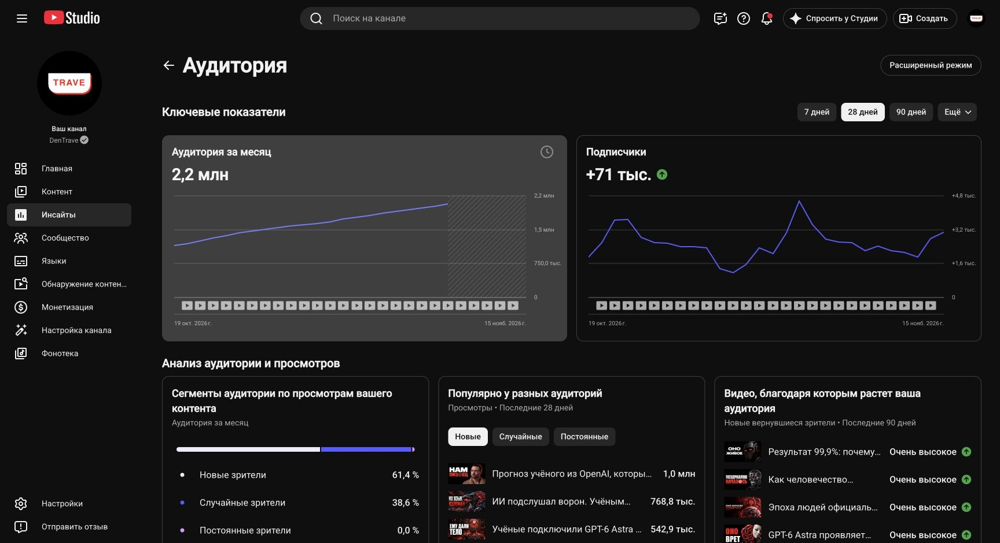
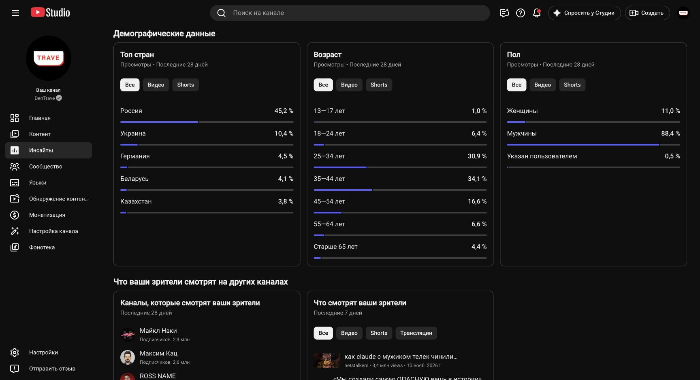

# DenTrave - медиакит для рекламодателей

**DenTrave** - YouTube-канал Дениса про искусственный интеллект и технологии. Длинные видео на русском языке: что происходит с нейросетями, как они меняют работу и жизнь, простым и живым языком.

Канал: [youtube.com/@DenTrave](https://www.youtube.com/@DenTrave)

## Цифры канала

Снимок YouTube Studio от 16.11.2026, период 19.10-15.11.2026 (последние 28 дней).

- **Аудитория за месяц:** 2,2 млн
- **Новых подписчиков за период:** +71 тыс.
- **География просмотров:** Россия - 45,2%, Украина - 10,4%, Германия - 4,5%, Беларусь - 4,1%, Казахстан - 3,8%
- **Возраст:** 25-34 года - 30,9%, 35-44 года - 34,1%, 45-54 года - 16,6%
- **Пол:** мужчины - 88,4%, женщины - 11,0%

Цифры округлены самой платформой и относятся к указанному периоду.

## Рекламные кейсы

Интеграции, которые уже вышли на канале. Просмотры роликов по данным YouTube на 19.11.2026.

- **Пипл** (зарубежные карты и eSIM) - 393 тыс. просмотров. Ролик «Никогда не пиши ЭТО в ChatGPT», 29.10.2026. [Смотреть](https://youtu.be/ytTdqR_zYVg)
- **Kodacode** (ИИ для программистов) - 299 тыс. просмотров. Ролик про записи мыслей GPT-6 Astra, 10.11.2026. [Смотреть](https://youtu.be/pQbqpm4K7_Q)
- **Syntx AI** (100+ ИИ-инструментов в одном месте) - 246 тыс. просмотров. Ролик «ИИ получил тело и вышел в продажу», 30.10.2026. [Смотреть](https://youtu.be/9qxL7YBPpvs)
- **chataibot** (доступ к нейросетям) - 206 тыс. просмотров. Ролик «Fable 5.2 против GPT-6 Astra и Opus 5.5», 11.11.2026. [Смотреть](https://youtu.be/nQtOGUpP0YU)
- **Zarub** (виртуальные карты Visa/Mastercard) - 171 тыс. просмотров. Ролик «Я потратил больше 1000$ на подписки ИИ», 12.11.2026. [Смотреть](https://youtu.be/kemyzkbiHWM)
- **GGSel** (подписки ChatGPT, Cursor, Claude) - 168 тыс. просмотров. Ролик «Зачем учиться, если есть ИИ», 14.11.2026. [Смотреть](https://youtu.be/IYRuo2auBAg)
- **GGSel** - 124 тыс. просмотров. Ролик про GPT-6 Astra и разум леса, 06.11.2026. [Смотреть](https://youtu.be/R2UnZ7h2lNs)

Ролики продолжают набирать просмотры после выхода, цифры выше - на дату обновления страницы.

## Формат рекламы

- **Интеграция внутри видео** - реклама встроена в ролик и подаётся в стиле канала.
- **Место:** обычно в первой трети ролика, когда зритель уже смотрит, но ещё не ушёл.
- **Длительность:** чаще всего слот на 45-60 секунд.
- **Короче или длиннее:** интеграция до 30 секунд стоит дешевле, дольше 60 секунд - дороже.
- **Ссылка на продукт** - в описании ролика, детали обсуждаем.

## Как мы работаем

- **Только фиксированная оплата.** За процент от продаж, CPA и оплату за результат не работаем.
- **Гарантий просмотров и продаж не даём.** Показываем реальную статистику канала и прошлые кейсы, а результат зависит от продукта и предложения.

## Стоимость

Цена, дата выхода и детали обсуждаются индивидуально с каждым клиентом. Пакет из нескольких интеграций обсуждаем отдельно.

## Как начать

1. Напишите в Telegram-бот [@Dentravebot](https://t.me/Dentravebot) - сообщения читает живой человек и отвечает там же.
2. Пришлите ссылку на продукт, желаемый формат и сроки.
3. Согласуем стоимость, дату и подачу.

Почта для предложений: [ads@dentrave.com](mailto:ads@dentrave.com)
